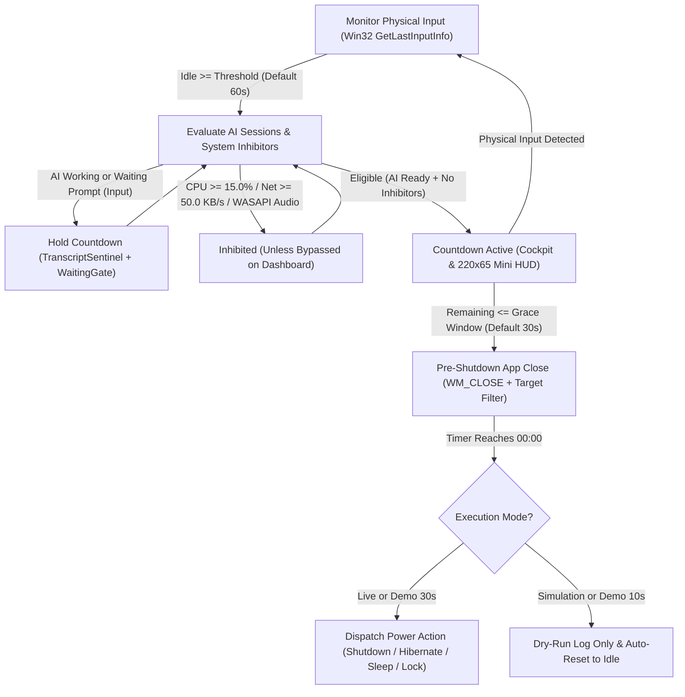

<div align="center">

# Smart Shutdown

**Intelligent Windows 10/11 inactivity daemon, Antigravity AI session sentinel, hardware/audio inhibitor engine, and Fluent Dark power cockpit.**

[](https://www.python.org/)
[](#prerequisites)
[](#gui-tabs--controls-guide)
[](LICENSE)

</div>

---

## Table of Contents

- [Features](#features)
- [Architecture & Lifecycle](#architecture--lifecycle)
- [Quick Start & Installation](#quick-start--installation)
- [Launchers & CLI Reference](#launchers--cli-reference)
- [GUI Tabs & Controls Guide](#gui-tabs--controls-guide)
- [UI Preview & Visual Layout](#ui-preview--visual-layout)
- [Configuration, Safety & Project Layout](#configuration-safety--project-layout)
- [Troubleshooting & FAQ](#troubleshooting--faq)
- [Contributing Guidelines](#contributing-guidelines)
- [License & Author](#license--author)

---

## Features

- **Unified Fluent Dark Desktop Cockpit (`780x520`):** Built in `tkinter` (`minsize 720x500`) with Studio dual-column (`>= 600px`) and Compact stacked layouts across `Dashboard`, `Telemetry`, `Logs`, `History`, and `Settings` tabs.
- **Floating Mini HUD (`220x65` px):** Draggable `HWND_TOPMOST` overlay (enabled on startup by default) with a `20px` triple-status header, `16pt` countdown clock, `9pt` inactivity chip, 4-button cluster (`⏸`, `🔄`, `📥`, `🪟`), and `4px` dual-tier progress bar.
- **Smart Inactivity & Dual-Ring Gauge:** Polls Win32 `GetLastInputInfo` (`ctypes`) and `GetTickCount64` (49.7-day rollover safe), driving a `240x240` dual concentric gauge (outer countdown ring + inner inactivity ring).
- **Antigravity AI Session Awareness:** `TranscriptSentinel` inspects `~/.gemini/antigravity/brain/*/.system_generated/logs/transcript.jsonl`, child worker trees (`core/process_tree.py`), and tri-modal waiting gates (`core/waiting_gate.py`: `Hybrid` 10m default, `Fixed Timer`, `Unlimited`), updating `[ 💬 Waiting ]`, `[ ⚙️ Working ]`, and `[ ✨ Ready ]` pills.
- **Hardware & Media Inhibitors:** Pauses arming when limits trigger: `CPU >= 15.0%` (`1`–`100%`), `Network >= 50.0 KB/s` RX+TX (`0`–`1000 KB/s` slider, clamped `0`–`10000 KB/s`), and `WASAPI` audio playback (`pycaw`/`comtypes`, peak `> 0.001`, enabled by default).
- **Power Actions & Modes:** Executes `Shutdown` (`shutdown.exe /s /t 0`), `Hibernate`, `Sleep`, or `Lock Screen` after `WM_CLOSE` + targeted app closure (`33` apps). Modes: `Live` (`15m`/`900s`, `60s` idle), `Simulation` (`5m`/`300s` dry-run, `60s` idle), `Demo (30s)` (`30s` real, `10s` idle/grace), and `Demo (10s)` (`10s` dry-run, `10s` idle, `2s` grace).
- **Atomic Persistence & Boot Auto-Startup:** `core/settings_store.py` saves atomically (`tempfile` + `flush` + `os.fsync` + `.json.bak` rotation + `os.replace`) with `.bak` self-healing; `core/startup.py` manages `%APPDATA%\Microsoft\Windows\Start Menu\Programs\Startup\Smart_Shutdown.lnk` (`pythonw.exe --mini-hud`).

---

## Architecture & Lifecycle



---

## Quick Start & Installation

### Prerequisites

- **OS:** Windows 10 or Windows 11 (x64)
- **Python:** Python 3.10+ with `tkinter` enabled (included in standard Windows Python installers)

### Setup & First Launch

```powershell
git clone <repository-url>
cd "Smart Shutdown"
pip install -r requirements.txt
```

> **Dependencies:** `psutil>=5.9.0` and `pillow>=10.0.0` are core; `pycaw>=20240210`, `comtypes>=1.2.0`, and `pystray>=0.19.0` enable WASAPI audio inhibition and system tray docking (degrading gracefully if absent). Primary Win32 APIs use built-in `ctypes`, with `pywin32>=306` optional.

Double-click **`Smart_Shutdown.bat`** for direct GUI launch (`smart_shutdown.py --gui` with 5-path Python lookup), or run from PowerShell:

```powershell
.\Smart_Shutdown.bat
python smart_shutdown.py --gui --no-mini-hud
```

---

## Launchers & CLI Reference

### Batch Launchers (`Smart_Shutdown.bat` & `launchers/`)

All batch files pass through CLI flags and accept `--no-pause` to skip pause prompts.

| Launcher | Underlying Target | Mode & Behavior |
| :--- | :--- | :--- |
| `Smart_Shutdown.bat` | `smart_shutdown.py --gui` | Direct Unified GUI launcher; forwards flags (`!FORWARD_ARGS!`) |
| `launchers/00_Quick_30s_Real_Test_Mode.bat` | `scripts/00_quick_30s_real_test_mode.py` | Mode 0 — `30s` live countdown (`10s` idle, app close at `T-10s`, real shutdown) |
| `launchers/01_Production_Monitor_5Min.bat` | `scripts/01_production_monitor_5min.py` | Mode 1 — `5m` (`300s`) legacy production countdown (`60s` idle buffer) |
| `launchers/02_Production_Monitor_10Min.bat` | `scripts/02_production_monitor_10min.py` | Mode 2 — `10m` (`600s`) legacy production countdown (`60s` idle buffer) |
| `launchers/03_Safe_Test_Dry_Run.bat` | `scripts/03_safe_test_dry_run.py` | Mode 3 — `30s` safe dry-run monitor (`10s` idle buffer, no app close/shutdown) |
| `launchers/04_Immediate_GUI_Preview_Test.bat` | `scripts/04_immediate_gui_preview_test.py` | Mode 4 — `20s` immediate countdown GUI & chime preview (`dry_run=True`) |
| `launchers/05_Single_Detection_Status_Check.bat` | `scripts/05_single_detection_status_check.py` | Mode 5 — One-shot Antigravity session status check and exit |
| `launchers/06_Cancel_or_Exit_Monitor.bat` | `scripts/06_cancel_or_exit_monitor.py` | Mode 6 — Run `shutdown /a`, clean lock file, and stop background monitor |
| `launchers/07_Toggle_Windows_Boot_Startup.bat` | `scripts/07_toggle_windows_boot_startup.py` | Mode 7 — Toggle `Smart_Shutdown.lnk` in Windows Startup folder |
| `launchers/08_Preview_Settings_GUI.bat` | `scripts/preview_settings_gui.py` | Mode 8 — Standalone Fluent Dark Settings window preview |
| `launchers/09_Preview_Countdown_Overlay.bat` | `scripts/preview_countdown_overlay.py` | Mode 9 — Standalone `20s` `HWND_TOPMOST` `CountdownOverlay` preview |

### Key CLI Flags (`smart_shutdown.py`)

| Flag | Description |
| :--- | :--- |
| `--gui` | Launch Unified Fluent Dark Desktop Cockpit (default) |
| `--mini-hud` | Start in compact `220x65` `HWND_TOPMOST` Mini HUD (`--mini`, `--hud`) |
| `--no-mini-hud` | Override `mini_hud_on_startup` and open full `780x520` cockpit (`--full-gui`) |
| `--headless` | Run background monitor without spawning GUI window |
| `--dry-run` | Safe Simulation mode without closing apps or OS power actions (`--test`) |
| `--countdown <sec>` | Override countdown (`simulation_timer_sec` in dry-run/Sim, `master_shutdown_timer_min` in Live; default `900s`) |
| `--idle-buffer <sec>` | Override physical inactivity silence threshold (default `60s`) |
| `--check-once` | Inspect Antigravity sessions once and exit (`0` complete, `1` active) |
| `--startup-status` | Show Windows Startup `Smart_Shutdown.lnk` status and configuration |
| `--enable-startup` | Create `Smart_Shutdown.lnk` in Windows Startup folder (`--mini-hud`) |
| `--disable-startup` | Remove `Smart_Shutdown.lnk` (and legacy shortcut) from Windows Startup |
| `--force-close-test` | Print processes/windows targeted at `T-10s` without terminating |
| `--help` | Print full CLI options, defaults, and usage examples |

> Additional flags: `--toggle-startup`, `--poll-interval`, `--window-hours`, `--since-start`, `--wait-for-task`, `--log-file`, `--debug`, `--no-hide`, `--force-close`, `--test-shutdown-skip`, and `--test-gui`.

---

## GUI Tabs & Controls Guide

- **Title Bar Cluster:** `🛡️ Smart Shutdown` branding, **AI Pill** (`[ ✨ Ready ]`, `[ ⚙️ Working ]`, `[ 💬 Waiting ]`), **Sentinel Pill** (`[ 💤 Idle ]`, `[ 🟢 Active ]`, `[ 👤 Away ]`, `[ ⏱️ Running ]`, `[ ⏸️ Paused ]`, `[ 🚪 Closing ]`, `[ 🛑 Blocked ]`), **Mode Switcher** (`Live` -> `Demo (30s)` -> `Simulation`), and window controls (`📌` Mini HUD, `︿` Tray, `—` Minimize, `✕` Close).
- **Tab 1 — `🎛️ Dashboard`:** `240x240` Dual Concentric Circular Gauge, 4 Informative Live Health Summary cards (`CPU Activity`, `Network Transfer`, `Antigravity Task`, `User Inactivity`), dynamic Eligibility Banner with hover tooltip, and 2x3 action pills (`Pause`/`Resume`, `+15m Snooze`, `Toggle Monitor`, `Abort`, `Bypass Blocks`, `Shutdown Now`).
- **Tab 2 — `📊 Telemetry`:** 2x2 grid showing `CPU Activity & Load` sparkline, `Network Throughput & I/O` RX/TX sparkline, `Antigravity AI Monitor` (PIDs, Workers, RAM), and `Input & WASAPI Audio` (`IDLE`, `ACTIVE`, `AWAY`, `AUDIO`).
- **Tab 3 — `📝 Logs`:** `Diagnostics` and `Errors` sub-tabs, live search, severity dropdown (`All`, `Info`, `Health`, `AI Gate`, `Warn`, `Crit`), 2,000-entry color console, `Copy All`, `Clear Console`, `Export`, and `Auto-Scroll`.
- **Tab 4 — `📜 History`:** 5 event sub-tabs (`Power`, `Blockers`, `Snoozes`, `Dry-Run`, `Sessions`), search, date filter, 3 KPI chips, `Clear History`, and `Export CSV`.
- **Tab 5 — `⚙️ Settings`:** Search bar + 4 sub-tabs with `Reset Defaults` and `Save Changes`:
  - `General`: Start with Windows (`Smart_Shutdown.lnk`), Minimize to System Tray on close, Show floating Mini HUD on startup.
  - `Application`: Master toolbar (`Select All`, `Deselect All`, `Restore Saved`, `Expand All`, `Collapse All`, counter) + 6 collapsible categories (`33` app targets with tri-state checkboxes).
  - `Limits`: Sliders for `Inactivity Timeout` (`1`–`120m`), `Master Countdown Timer` (`1`–`60m`), `Simulation Duration` (`10`–`900s`), `CPU Activity Threshold` (`1`–`100%`), `Network Throughput Threshold` (`0`–`1000 KB/s`), and `WASAPI Audio Stream Inhibit`.
  - `Actions`: Radios for `Target Power Action` (`Shutdown`, `Hibernate`, `Sleep`, `Lock Screen`) and `Coordinator Execution Mode` (`Live`, `Demo (30s)`, `Simulation`).
- **Mini HUD & System Tray:** Drag the `220x65` Mini HUD or double-click to expand; click its mode badge (`⚡ Live` / `🧪 Demo` / `🛡️ Sim`) or `⏸`, `🔄`, `📥`, `🪟`. Right-click the `pystray` tray icon for `Show Cockpit`, `Show / Hide Mini HUD`, `Pause / Resume`, `+15m Snooze`, `Toggle Monitor`, or `Exit Smart Shutdown`.

---

## UI Preview & Visual Layout

### 780x520 Unified Desktop Cockpit (`Dashboard` View)

```text
+------------------------------------------------------------------------------+
| 🛡️ Smart Shutdown  [ ✨ Ready ] [ 💤 Idle ] [ ⚡ Live ]      📌  ︿  —  ✕   |
+--------------+--------------+--------------+---------------+-----------------+
| 🎛️ Dashboard | 📊 Telemetry |   📝 Logs    |  📜 History   |   ⚙️ Settings   |
+--------------+--------------+--------------+---------------+-----------------+
|  +----------------------------------+  Informative Live Health Summary       |
|  |         .--------------.         |  +----------------------------------+  |
|  |       /   240x240 Dual   \       |  | ✔ CPU Activity    0.0% [Safe] [=]|  |
|  |      |       15:00        |      |  +----------------------------------+  |
|  |      | MINUTES REMAINING  |      |  +----------------------------------+  |
|  |       \    USER IDLE     /       |  | ✔ Network Transfer 0.0 KB/s  [=]|  |
|  |         '--------------'         |  +----------------------------------+  |
|  +----------------------------------+  +----------------------------------+  |
|  +----------+----------+----------+    | ✔ Antigravity Task [✨ Ready] ●  |  |
|  | || Pause |zᶻ+15m Snz|🖥 Monitor|    +----------------------------------+  |
|  +----------+----------+----------+    +----------------------------------+  |
|  +----------+----------+----------+    | ✔ User Inactivity 0s / 60s    [=]|  |
|  | ✕ Abort  |🛡 Bypass |⚡Shutdown|    +----------------------------------+  |
|  +----------+----------+----------+    +----------------------------------+  |
|                                        | ✔ System Eligible — No Inhibitors|  |
|                                        +----------------------------------+  |
+------------------------------------------------------------------------------+
```

### 220x65 Floating Mini HUD (`HWND_TOPMOST`)

```text
+---------------------------------------------+
| ⚡ HUD         [✨ Ready] [💤 Idle] [⚡ Live]|  20px Triple-Status Header
+---------------------------------------------+
|  15:00  [0:00]     [⏸]  [🔄]  [📥]  [🪟]   |  41px Clock, Idle Chip & Actions
+=============================================+  4px Dual-Tier Progress Bar
```

- **Non-Destructive UI Previews:** Test windows safely with [`launchers/04_Immediate_GUI_Preview_Test.bat`](launchers/04_Immediate_GUI_Preview_Test.bat) (`20s` dry-run countdown + alert chime), [`launchers/08_Preview_Settings_GUI.bat`](launchers/08_Preview_Settings_GUI.bat) (Settings window), or [`launchers/09_Preview_Countdown_Overlay.bat`](launchers/09_Preview_Countdown_Overlay.bat) (`20s` `HWND_TOPMOST` overlay).
- **Adding Screenshots Later:** If you capture local screenshots for forks or releases, place PNG files in an `assets/` folder (omitted from default tracking to keep the repo lean).

---

## Configuration, Safety & Project Layout

### Configuration & Recovery

- `smart_shutdown_settings.json` is created in the repository root on first save (gitignored to keep workstation preferences local).
- Every save uses atomic `tempfile` + `flush` + `os.fsync` + `os.replace` with `smart_shutdown_settings.json.bak` rotation and automatic self-healing on primary file corruption.

### Safety Guarantees

- **Critical OS & Tree Protection:** `CRITICAL_OS_WHITELIST` (46 system executables), shell desktop classes (`Progman`, `WorkerW`, `Shell_TrayWnd`), all Python processes, and ancestor launcher PIDs (`get_ancestor_process_ids`) are immune from termination.
- **Single-Instance Lock & Graceful Shutdown Prep:** `smart_shutdown.lock` stores the active PID with identity validation (`_is_smart_shutdown_pid`) before replacing stale instances, and live power actions flush logs and release the lock pre-dispatch.
- **Dry-Run Isolation:** `Simulation` (`300s`) and `Demo (10s)` modes never close apps or call OS power commands, auto-resetting to `IDLE_MONITORING`.

### Project Structure

```text
Smart Shutdown/
├── smart_shutdown.py              # Unified CLI & GUI entrypoint dispatcher
├── Smart_Shutdown.bat             # Direct GUI batch launcher with flag pass-through
├── core/                          # Coordinator, Win32 hooks, inhibitors, tray, atomic store & power dispatch
├── gui/                           # Fluent Dark 5-tab Tkinter cockpit, Mini HUD, overlays & dialogs
├── launchers/                     # 10 preset Windows .bat launchers (Modes 0–9)
├── scripts/                       # Preset Python runners, UI previews & rules health check
├── changes_log/                   # 5-tier project change history & audit trail
├── .agents/rules/                 # Project engineering governance rules
├── requirements.txt               # Core and optional Windows Python dependencies
├── package.json                   # Node metadata & rules:check script
├── cliff.toml                     # git-cliff changelog configuration
├── CHANGELOG.md                   # Conventional Commits changelog
├── memory.md                      # Project architecture & working memory dossier
└── LICENSE                        # MIT License
```

---

## Troubleshooting & FAQ

- **Python not found / `Smart_Shutdown.bat` fails:**
  - All batch launchers probe 5 paths in order: `%USERPROFILE%\.local\bin\python.exe`, `python` in `PATH`, `%USERPROFILE%\.venv\Scripts\python.exe`, `%LOCALAPPDATA%\Programs\Python\Python*\python.exe`, and `%ProgramFiles%\Python*\python.exe`.
  - Verify Python `3.10+` has `tkinter` enabled and run `pip install -r requirements.txt`. Pass `--no-pause` to skip batch pause prompts in scripted runs.
- **Windows Boot Auto-Startup toggle (`Smart_Shutdown.lnk`):**
  - Creates `%APPDATA%\Microsoft\Windows\Start Menu\Programs\Startup\Smart_Shutdown.lnk` targeting `pythonw.exe --mini-hud` (falling back to `sys.executable`), controlled via `launchers/07_Toggle_Windows_Boot_Startup.bat` or `--startup-status` / `--enable-startup` / `--disable-startup` / `--toggle-startup`. Saving in `Settings` triggers `reconcile_startup_shortcut` to keep `.lnk` flags synced.
- **Countdown blocked or paused by inhibitors:**
  - Triggered when `WASAPI` audio peak `> 0.001`, `CPU >= 15.0%`, `Network >= 50.0 KB/s`, or Antigravity AI is `WORKING` / `WAITING_USER_PROMPT` (`Hybrid` `10m` default gate). Adjust thresholds in `Settings -> Limits` or use **`Bypass Blocks`** on the `Dashboard`.
- **Stuck background monitor, `smart_shutdown.lock`, or pending OS shutdown:**
  - Run [`launchers/06_Cancel_or_Exit_Monitor.bat`](launchers/06_Cancel_or_Exit_Monitor.bat) (or `python scripts/06_cancel_or_exit_monitor.py --force`): invokes `shutdown /a`, terminates the non-ancestor PID in `smart_shutdown.lock`, removes `smart_shutdown.lock` (and legacy `auto_shutdown.lock`), and includes an offline batch fallback if Python is missing.
- **Corrupted or missing `smart_shutdown_settings.json`:**
  - `core/settings_store.py` uses atomic `fsync` saves with `.json.bak` rotation and auto-recovers via `_recover_from_backup` from `smart_shutdown_settings.json.bak` to self-heal the primary file; if neither is valid, Smart Shutdown loads clamped `SettingsConfig` defaults.

---

## Contributing Guidelines

1. **Workflow & Commits:** Fork and branch from `master`; use Conventional Commits (`feat`, `fix`, `docs`, `chore`) compatible with [`cliff.toml`](cliff.toml).
2. **Code Standards & Security:** Follow Python `3.10+` style, Rule 28 modularity (`< 500` lines / `< 24 KB`), avoid hardcoded secrets or PII, and avoid unverified dependencies outside [`requirements.txt`](requirements.txt).
3. **Encoding & `.gitattributes`:** Keep `*.bat` as `CRLF` (`BOM=False`), and keep `.py`, `.md`, `.json`, `.js`, `.txt`, `.toml`, `LICENSE`, and dotfiles as `LF` (`BOM=False`, except governed `.agents/rules/` and `changes_log/` files which retain UTF-8 BOM + `LF`).
4. **Pre-PR Checklist:**
   - Syntax & CLI smoke (pass `-B` beside a running daemon): `python -B -m py_compile smart_shutdown.py` and `python -B smart_shutdown.py --help`
   - Safe non-destructive previews: `launchers/03_Safe_Test_Dry_Run.bat`, `launchers/08_Preview_Settings_GUI.bat`, `launchers/09_Preview_Countdown_Overlay.bat`
   - Governance & secrets: `npm run rules:check` and `gitleaks detect --redact --no-banner`
   - Confirm `git status --short` is clean (`smart_shutdown_settings.json`, `smart_shutdown.lock`, and `logs/` remain untracked).

---

## License & Author

- **Author:** Atul Verma ([`aiprincekumar`](https://github.com/aiprincekumar) · `aiprincekumar010100@gmail.com`)
- **License:** Distributed under the [MIT License](LICENSE).
